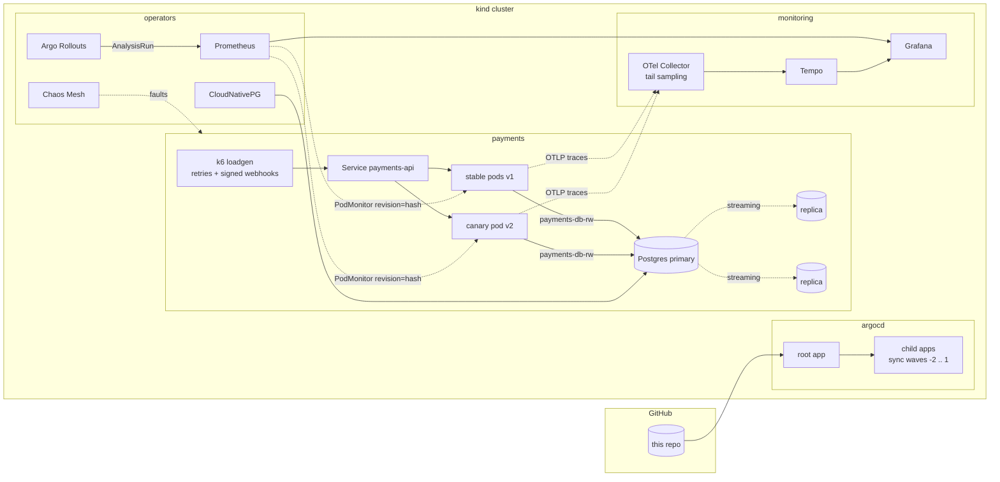
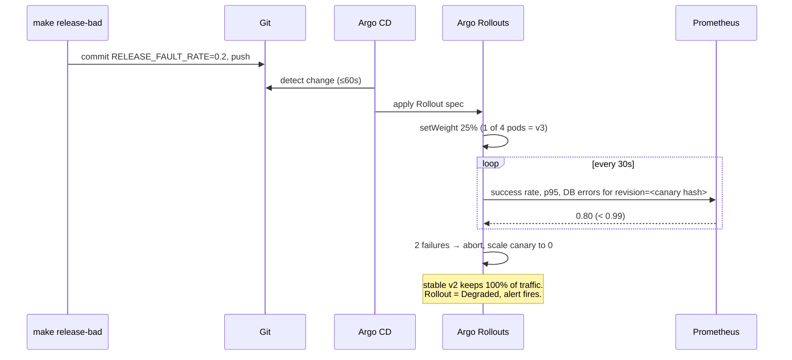

# Payments reliability lab

A payment service built to survive the things that cause duplicate charges
and outages in real systems: client retries, webhook redelivery, out-of-order
events, bad deploys, pod kills and a database failover. Every one of those is
reproduced here on purpose, measured in Grafana, and checked against business
invariants in Postgres afterwards.

**The one-line version:** bad releases roll themselves back before most users
see them, and no amount of retrying, killing or failing over produces a
second charge.

## Architecture



## What happens on a release



## What it demonstrates

| Area | How |
|---|---|
| **Idempotent writes** | `Idempotency-Key` + `UNIQUE` constraint + `INSERT … ON CONFLICT DO NOTHING`. 50 concurrent identical requests produce one row (`make test-idempotency`). Same key with a different body is rejected (422). |
| **Exactly-once webhook effects** | HMAC-SHA256 signature with signed timestamp (replay window 5 min), event-id primary key, row lock (`SELECT … FOR UPDATE`), status change + audit row in one transaction. |
| **Explicit state machine** | `pending → succeeded/failed`, `succeeded → refunded`. Out-of-order or late events are recorded and ignored, never applied. |
| **Safe retries** | Exponential backoff with jitter on transient SQLSTATEs only. Retries are safe *because* writes are idempotent. Exhausted retries return 503 + `Retry-After`. |
| **Progressive delivery** | Argo Rollouts canary 25 → 50 → 75 → 100% with background analysis on success rate, p95 latency and DB errors, filtered to the canary's pod-template hash. |
| **HA database** | CloudNativePG: 3 instances, automatic failover, pool health checks drop dead connections to the old primary. |
| **Probes done right** | Liveness never checks the DB, so a DB outage doesn't restart every pod and make recovery slower. |
| **Infrastructure as code** | Terraform creates the kind cluster, the webhook secret, Argo CD and the root app. Everything after that is GitOps. |
| **GitOps** | Argo CD app-of-apps with sync waves (Prometheus CRDs → operators → dashboards → app). Releases are Git commits. |
| **Observability** | Per-revision RED metrics, business metrics (replays, duplicates, ignored events), hand-written multi-window burn-rate alerts. |
| **Distributed tracing** | OpenTelemetry SDK (FastAPI + psycopg + custom spans), every DB retry recorded as a span event, `X-Trace-Id` on responses. OTel Collector tail-samples (all errors, all slow requests, 10% baseline) into Grafana Tempo. |
| **Chaos** | Chaos Mesh: kill DB primary, DB latency, DB partition, app pod kills, CPU stress. Each run ends with an invariant check. |

## Quickstart

**Needs:** Docker (≈8 GB RAM), kind, kubectl, Terraform ≥ 1.6, git, and the
[kubectl-argo-rollouts](https://argoproj.github.io/argo-rollouts/installation/#kubectl-plugin-installation) plugin.

```bash
# Push this repo to your GitHub (public, so Argo CD can read it without creds)
make init GH_USER=<your-github-user>
git commit -am "chore: point argo at my fork" && git push

make up          # terraform (kind + secret + Argo CD + root app), then build/load image (~5-8 min)
make status      # wait until all Applications are Synced/Healthy
```

In separate terminals:

```bash
make grafana     # http://localhost:3000  → "payments · reliability"
make argocd-ui   # http://localhost:8081
make watch       # live canary view
```

## Try it

```bash
# Releases
make release-good     # v2: walks 25→50→75→100, analysis passes
make release-bad      # v3: 20% errors, aborted at 25%
make release-slow     # v4: +400ms, aborted on p95
# After an abort, Git still says v3. Recover the GitOps way:
git revert HEAD && git push

# Tracing: every response carries X-Trace-Id
kubectl -n payments port-forward svc/payments-api 18080:80 &
curl -si -X POST localhost:18080/payments -H 'Idempotency-Key: demo-1' \
  -H 'Content-Type: application/json' -d '{"amount_minor":1000,"currency":"INR","customer_id":"c1"}' | grep -i x-trace-id
# Grafana → Explore → Tempo → paste the ID (or use the "Traces" row on the dashboard)

# Correctness
make test-idempotency # 50 parallel identical requests → 1 payment
make invariants       # 5 business invariants, all must be 0

# Chaos (each ends with an invariant check)
make chaos-db-primary     # failover under load
make chaos-db-partition   # 45s with no database
make chaos-db-latency
make chaos-app-pods
make chaos-cpu
```

Write down your hypothesis first: [`docs/chaos-experiments.md`](docs/chaos-experiments.md).

## Repository layout

```
terraform/              kind cluster, webhook secret, Argo CD + root app
bootstrap/              Argo CD Helm values, kind config (for the manual path)
argocd/                 root app + child apps (operators, monitoring, payments)
services/payments-api/  FastAPI + psycopg3 service, unit + integration tests
deploy/payments/        Rollout, AnalysisTemplate, CNPG Cluster, PodMonitor, NetworkPolicy, loadgen
deploy/platform/        alert rules, Grafana dashboard
chaos/                  Chaos Mesh experiments
scripts/                release, chaos runner, invariant checks, webhook sender
loadtest/               k6 spike test
docs/                   design, ADRs, runbooks, postmortems, interview notes
```

## Docs

- [Design: data model, state machine, failure analysis](docs/design.md)
- ADRs: [canary with analysis](docs/adr/0001-canary-with-automated-analysis.md) ·
  [SLOs](docs/adr/0002-slos.md) · [CloudNativePG](docs/adr/0003-cloudnative-pg.md) ·
  [probes and the database](docs/adr/0004-probes-and-db.md) ·
  [tracing and tail sampling](docs/adr/0005-tracing-and-tail-sampling.md) ·
  [Terraform bootstraps, GitOps runs](docs/adr/0006-terraform-bootstraps-gitops-runs.md)
- Runbooks: [canary aborted](docs/runbooks/canary-aborted.md) ·
  [database failover](docs/runbooks/database-failover.md) ·
  [error budget burn](docs/runbooks/error-budget-burn.md) ·
  [suspected duplicate charge](docs/runbooks/suspected-duplicate-charge.md)

## Known limitations

- Canary weight is by pod count (1 of 4 = 25%) because there's no traffic
  router. With the Gateway API plugin for Argo Rollouts the split would be exact.
- The webhook secret is created by a script. In production it would come from
  a secret manager via External Secrets (see my other project).
- No real payment provider; the load generator plays the provider.
- Chart versions use ranges; pin them once you've tested a set.
