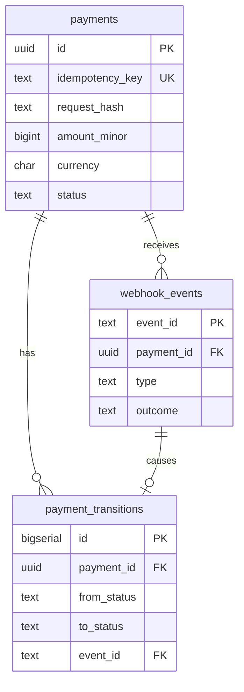
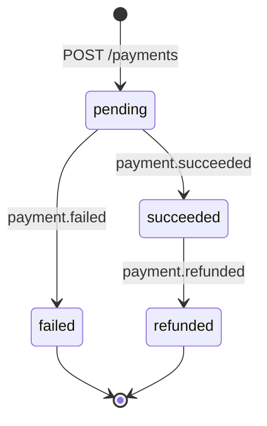
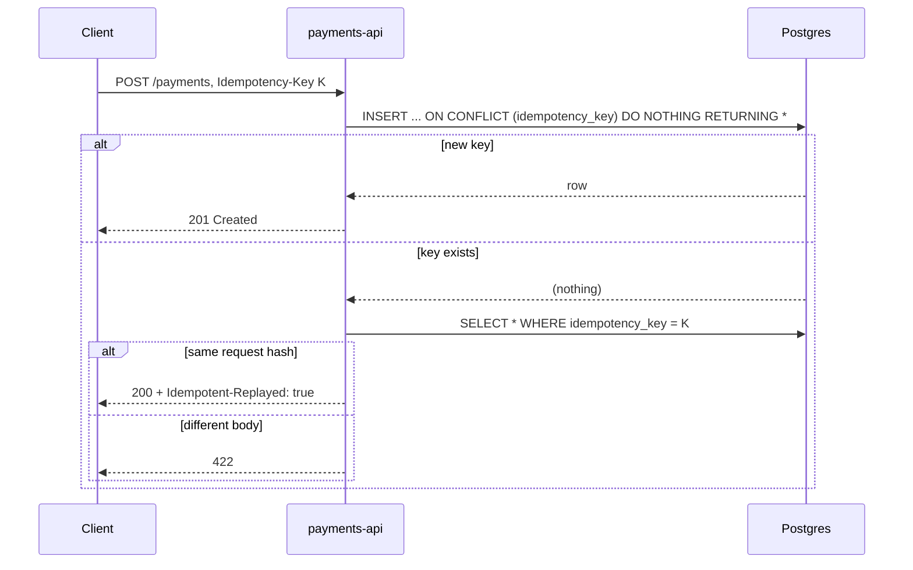

# Design

## Requirements

1. A client retrying a request (timeout, network blip, 5xx) must never create a second payment.
2. A provider redelivering a webhook must never apply its effect twice.
3. Events can arrive out of order; the payment must only move along valid transitions.
4. Every status change must be auditable.
5. A database failover or a bad release must not violate 1–4, and should be
   invisible or brief for clients.

## Data model



Amounts are integers in the smallest currency unit (paise). Floats can't
represent money exactly.

## State machine



Anything else (refund before success, success after failure, a second
success) is stored in `webhook_events` with `outcome=ignored` and returns 200
so the provider stops retrying, but the payment doesn't change.

## Create payment: how idempotency works



Why not "SELECT first, then INSERT if missing"? Two concurrent requests both
see nothing and both insert. `ON CONFLICT` makes the check and the insert one
atomic step, enforced by the unique index.

## Webhook: one transaction

```
BEGIN
  SELECT status FROM payments WHERE id = $1 FOR UPDATE      -- serialize per payment
  INSERT INTO webhook_events ... ON CONFLICT DO NOTHING     -- dedupe by event_id
  -- nothing inserted?  → duplicate, return 200
  UPDATE payments SET status = ...                         -- only if transition valid
  INSERT INTO payment_transitions ...                      -- audit
COMMIT
```

If the pod dies before COMMIT, nothing is written and the provider retries.
If it dies after COMMIT but before responding, the provider retries and gets
`duplicate`. Either way the effect happens exactly once.

## Failure analysis

| Failure | What happens | Client sees |
|---|---|---|
| Client retries after timeout | `ON CONFLICT` returns existing row | 200, same payment |
| Commit succeeded, connection dropped before ack, app retries | retry hits the conflict path | 200/201, one payment |
| Provider redelivers event | event_id PK conflict | 200 `duplicate` |
| Refund arrives before success | invalid transition | 200 `ignored`; status unchanged |
| Webhook before create is visible | payment not found | 404 → provider retries later |
| App pod killed | readiness drops, preStop drains, in-flight txn rolls back | none (retried by client/loadgen) |
| DB primary killed | CNPG promotes replica in ~10-30s; pool health check drops dead conns; backoff retries cover most of it | brief latency spike; some 503 if failover > ~6s retry budget |
| DB unreachable for 45s | retries exhausted | 503 + Retry-After, no restarts, auto-recovery |
| Bad release | canary analysis fails on revision hash metrics | errors on ~25% of traffic for ~1-1.5 min, then none |

## Observability: what each signal answers

| Question | Signal |
|---|---|
| Is the service meeting its SLO? | Prometheus recording rules + burn-rate alerts |
| Is the canary worse than stable? | metrics with `revision` label |
| Why did *this* request fail or take 2 s? | trace in Tempo: SQL spans + `db.retry` events |
| Did a failure break correctness? | `make invariants` against Postgres |
| What did the customer see? | `X-Trace-Id` from their response → trace |

## Capacity notes

4 pods × pool max 10 = 40 connections, under `max_connections=100` with room
for a full canary surge (5 pods = 50) and CNPG's own connections. Raising
replicas means revisiting the pool size or adding PgBouncer (CNPG `Pooler`).
